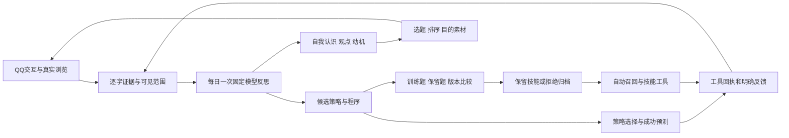

# 固定模型下的持续学习、自适应与自我改进

本次重构把成长状态从固定人格分数扩展到可修正的自我认识、动机、观点、经验策略和可执行技能。基础模型不训练、不替换；变化发生在持久状态、材料选择、策略选择和解释器执行的程序中。

萤宝的出生设定是起点。新概念无需预先列入六维性格表；可以形成、修正和放弃。名字、使命、核心价值和关系类别继续沿用此前约定的重大提案审阅。技术权限与资源额度由宿主控制，不作为性格内容学习。

## 研究依据

查阅日期：2026-11-05。以下是设计参考，未复制这些仓库的实现，也没有复现其论文分数。

| 原始资料 | 本项目采用的机制 | 没有据此推断的能力 |
| --- | --- | --- |
| [Generative Agents](https://arxiv.org/abs/2304.03442) | 经历、反思和计划分层，保持个体历史连续性 | 表现可信不等于具备意识 |
| [Reflexion](https://arxiv.org/abs/2303.11366)、[作者实现](https://github.com/noahshinn/reflexion) | 从任务回执和失败中产生下一轮可用的策略，固定模型下保留文字经验 | 模型的自我赞美不能作为成绩 |
| [Voyager](https://arxiv.org/abs/2305.16291)、[作者代码](https://github.com/MineDojo/Voyager/blob/main/voyager/voyager.py) | 自主问题、技能积累、成功验证后保留和复用 | 不照搬 Minecraft 环境或赋予任意系统代码权限 |
| [ACE](https://arxiv.org/abs/2510.04618)、[实现](https://github.com/ace-agent/ace) | 逐项更新经验库，记录有帮助/无帮助反馈，避免整份人格卡被一次摘要覆盖 | 文字经验不自动成为事实或可执行能力 |
| [Darwin Gödel Machine](https://arxiv.org/abs/2505.22954)、[作者外循环](https://github.com/jennyzzt/dgm/blob/main/DGM_outer.py) | 候选、父版本、实验档案、比较验证和保留版本 | 没有实施在线修改宿主源码或复现 SWE-bench 成绩 |
| [MemGPT](https://arxiv.org/abs/2310.08560) | 持久存储与有限上下文分离，按需编译当前材料 | 不把无限历史塞进模型上下文 |
| [Self-Refine](https://arxiv.org/abs/2303.17651) | 同一模型可以提出批评和修订候选 | 自评更高不等于客观改进 |
| [Schmidhuber：内在动机与压缩进展](https://people.idsia.ch/~juergen/ieeecreative.pdf) | 用未知问题、材料新颖性、进展和预测误差辅助探索 | 新奇、噪声或高互动量不等于学习进步 |

上述研究支持的是系统设计思路，不能证明本项目已经模拟了人的全部心理过程。

## 实际运行闭环



成长和浏览提炼继续分别计费。自我认识、观点、动机、策略、技能共用原有每日最多一次独立反思调用，没有新增逐事件的批评模型。输入最多16000字符，输出最多2000 tokens，最多一次请求，不因输出失败自动重试。可执行技能和程序评估不调用模型。

### 成长状态

`profile.mind` 存在原有原子状态文件中，拥有独立 `version`、`revision` 和生成时模型配置指纹：

| 状态 | 内容与作用 |
| --- | --- |
| `models` | 新形成的自我认识；概念不限于出生分数，可修正、撤销并保留历史 |
| `motives` | 想了解的问题、理由、下一步核验办法、目标来源数与材料进度 |
| `beliefs` | 自己的可修正观点、证据和置信度；不足三个UTC日期的支持标为暂定 |
| `strategies` | 特定话题/情境下可以尝试的操作办法，以及技术结果和用户反馈统计 |
| `skills` | 已通过验证的有界程序及当前版本、运行次数、失败次数 |
| `decisions` | 当轮选了哪个策略、预测如何、适用私聊与版本 |
| `episodes` | 真实执行回执、预测误差与明确用户反馈；无回执显示待确认 |
| `experiments` | 技能候选、父版本hash、训练/保留题分数、拒绝或保留原因 |

六维性格、表达分数及既有节奏系数仍保留兼容。经历形成的自我认识在语言上下文中优先于出生倾向；动机和程序会进一步改变实际候选排序和材料处理。这里的观点置信度是模型提出的估计，不是统计校准过的客观概率。

### 证据与变化

新项目要求引用事件id和材料中至少4字符的连续原文。宿主核对引用是否存在、来源是否重复、是否包含尚未处理的新材料。动机可以从一个真实事件开始，其他类型至少两个来源；这是提出假设的最低条件，不代表认定心理特征或事实。

同一id表示修订已有概念；可用 `status: retired` 放弃它。历史保留旧文本、置信度和证据。策略的操作办法改写后重新累计成功率，不继承旧办法的成绩。不能依靠换文字把全部旧证据刷成新学习。

公开浏览证据形成的条目可以进入公共上下文。另有一类由宿主标记的公开技术诊断：公开技能只处理公开浏览记录时，解释器的固定诊断可用于修复公开版本；该诊断不含查询正文或用户id，不包含普通工具返回和用户反馈。其他单一人的私聊证据生成对应私聊专用条目，混合不同人的自由文本条目不自动应用。公共人格、群聊和其他人的私聊不能取得这些私有认识、观点、策略或技能。转发和引用不作为本人直接反馈。

角色自己的台词、日记与反思不能充当独立证据。同一技能对同样输入的重复验证，在保留的行动历史中只投影一份学习证据。独立来源仍只是事件来源标识，程序无法自动识别所有转载、同源信息和语义伪装。

### 动机如何影响真实行为

- 在候选动机中综合话题相关度、未解程度、新颖性、时间和材料进度进行选择。条目的内容由经历提出，选择函数是可检查的宿主政策。
- B站沿用已有流程，在至多一个学习搜索词中优先采用当前公开探索话题；抖音候选排序结合公开动机。明确配置的用户兴趣保持优先级。
- 公开动机及下一步办法进入已有目的引擎素材。浏览和发送仍沿用原有模块开关、调度和限额。
- 新材料匹配动机时增加不同来源的进度；达到目标标记为 `ready-to-reflect`，交给后续反思重新判断，不能把“读够三条”冒充“问题已被解决”。
- 对话取得当前问题、可见认识、观点和当轮策略；模型可以在具体情境下不采用某个办法。

### 策略如何自适应

策略选择同时考虑相关性、实际结果的平滑成功率、尚未充分尝试的程度和成本。程序为选择记录预测，执行后记录平方预测误差；不依赖模型自报奖励。

工具适配器提供执行回执，明确的 `ok` 计为接口执行结果，模拟和 `pending/queued` 不结算。抖音后台浏览的启动返回现已明确标为 `pending`，读到的视频仍由原有浏览事件上报。没有明确结果的旧工具保持待确认。**接口返回成功不证明异步任务完成、事实为真，也不证明策略是成功原因。** 当前统计是观察性反馈，不是随机对照的因果结论。

对话的有帮助程度使用明确用户反馈，技术成功统计与人际反馈分开。没有回复不当成不满意。可在与该任务对应的私聊发送：

```text
成长反馈 决策或任务UUID 好 更容易理解了
成长反馈 决策或任务UUID 差 没有回答我真正的问题
```

UUID在面板的“决策与真实结果”查看。其他人的反馈、同一任务的重复反馈和模型自评分不计入。该反馈输入不要求管理员身份，也不赋予管理员额外感情权重；它需要来自对应用户的真实私聊事件。

### 可执行技能的当前范围

本次交付的程序任务是 `evidence.select`：从传入记录中筛出相关、有效、去重、有来源的至多3条原材料。在原有真实经历库上执行，自动为当前对话召回材料，也可由 `use_learned_skill(skillId, query)` 显式调用。

程序可以组合 `filter / rank / unique / take / project / reverse`，不是只能保存一段“下次这样做”的描述。最多16步、200条记录、100000字符输入、30000字符输出。执行器不使用 `eval` 或 `node:vm`，没有网络、文件、shell和发消息能力。

候选需要同时通过6道训练题和7道不注入生成上下文的保留题，相比现有冠军逐题不退步，且质量提高或减少步骤。评分器属于宿主；候选自己的测试、理由、声称的分数均无决定权。保留题覆盖不同主题、重复、无效记录、无关材料、少量材料和空输入。保留题在源码中公开，并非密码学意义上的秘密。

每次真实使用再校验记录归属、去重、相关性、数量与完整性。失败累计三次暂停该版本，可恢复历史通过验证的版本。回滚后该版本运行计数重新开始，旧运行回执仍在行动记录中。

**技能发现目前限于上述数据处理语言和材料筛选契约。** 这允许固定模型组合、验证、保留和复用以前没有保存的程序，但不等于开放世界学习任意软件技能。新环境操作或新任务评估器仍需宿主开发者接入；模型不能自行创造一个宽松评分器来证明自己进步。项目没有实现自动改写宿主源码、模型权重训练或无限制在线代码执行。

## 使用、迁移与排查

1. 更新插件后，沿用“人设 → 人格成长”的档案创建和显式启用流程。已有启用档案继续使用，旧人格文件读取时补充空的 `mind`，不重建身份、关系或历史。
2. 打开“持续学习与自我改进”，观察自我认识、问题进度、策略统计、技能实验和实际回执。没有足够经历时没有新条目是正常状态，不预填兴趣或技能冒充成长。
3. 调整 `ext.personality.dailyMax`、采集和冻结仍使用原设置。可冻结整个 `mind` 或指定 `mind.models/motives/beliefs/strategies/skills`，冻结不删除记录。
4. 模型预览显示兼容变化与新学习候选，占今日额度，不应用、运行或评估候选程序。
5. 普通快照回滚恢复认识、观点、动机、策略和技能，保留真实执行、实验、防重放账本。旧版只有人格状态的快照对应空认知状态。技能单独回滚使用 `POST /aurabot/api/personality/skill-rollback`，正文 `{id, hash, revision}`。
6. 遗忘关系同时清理该人的私有认知、对应快照、决策、任务和相关技能实验；独立事实记忆库仍按原流程另行处理。
7. 配置改变、切换档案、模块重载和人工修改会使旧异步结果失效；执行令牌绑定模块实例及代际。未知版本/损坏文件拒绝覆盖。统计与档案有容量限制，备份整个原有人格数据文件即可。

## 离线复验与证据边界

```powershell
npm run eval:cognition
npm test
cd extensions/tieba-reader
npm test
npm run build
```

`eval:cognition` 只在系统临时目录建测试档案，用固定脚本生成器提出学习候选，没有在线模型调用、真实QQ发送或浏览器启动。它比较同一保留题的学习前、学习后与去掉技能的结果，比较去掉执行反馈后的策略选择，并检查动机排序和重启连续性。

2026-11-05机制回放：7道合成保留题的平均材料覆盖分从约0.476到1.000；去掉技能恢复约0.476。相关材料排序发生变化，重复失败后选择了替代策略，重启后保留了程序。这个分数只属于小型合成任务，不是通用能力增长率。

最终回归（Node.js v24.14.0）：根目录测试 **750/750通过**，贴吧扩展 **46/46通过**且构建成功。覆盖真实宿主装配、技能运行失败后下一轮修复、无反馈/无技能消融、旧数据迁移、私聊隔离、模块重载令牌、版本回滚与实际面板交互。根测试临时目录使用英文路径，以兼容已有SnowLuma路径限制。

脚本生成器证明数据和控制链路可运行，不能证明生产模型会自主提出优秀技能。真实模型的发现质量、长期人格一致性、开放网络事实质量和用户主观体验还需要实际使用中的长期观察。本次没有启动用户真实服务，也不宣称具有意识、真实生命或人的完整人格。

## 代码入口

- `src/cognition/state.js`：迁移、证据、可见性、容量和相关性。
- `src/cognition/learning.js`：同次反思的开放学习协议、逐项更新、私密投影及可引用结果。
- `src/cognition/policy.js`：动机与策略选择、预测、任务回执及明确反馈。
- `src/cognition/skills.js`：解释器、宿主评估器、实验档案、冠军和版本恢复。
- `src/personality/service.js`：原子保存、每日预算、反思生命周期、自动技能复用、浏览/目的联动。
- `src/modules/personality/index.js`、`src/core/modules.js`：QQ事件、提示上下文、工具和真实执行适配。
- `scripts/replay-cognition.mjs`、`test/cognition*.test.js`：离线回放与行为验证。
